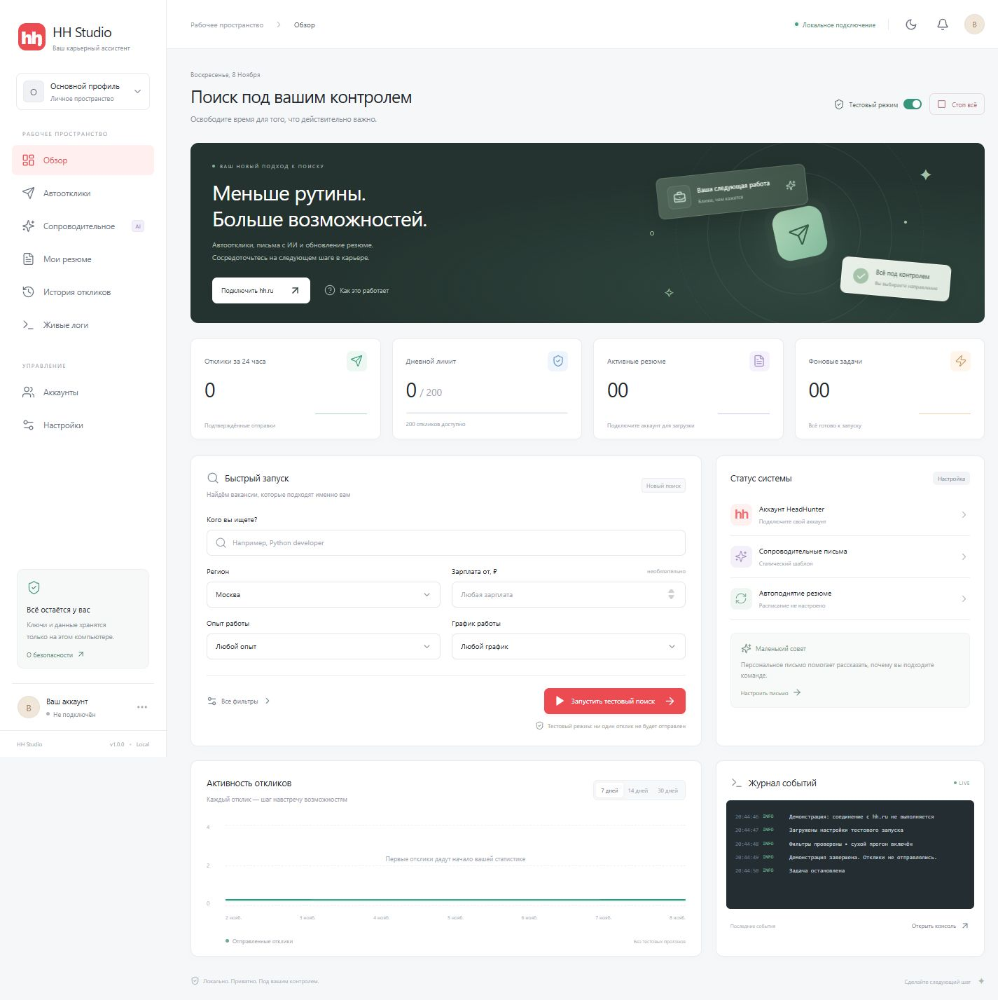

# HH Studio

Локальная веб-панель для [s3rgeym/hh-applicant-tool](https://github.com/s3rgeym/hh-applicant-tool). Все действия доступны в браузере: вход в hh.ru по коду, настройка поиска, автоотклики, письма с ИИ, поднятие резюме, расписания и живые логи.

**По умолчанию включён dry-run. Реальные отклики начнут отправляться только после отключения тестового режима.** Статистика изначально пустая; демонстрационных откликов, вымышленных резюме или поддельного статуса подключения нет.



## Запуск без терминала на Windows

При первом запуске приложение установит зависимости и соберёт интерфейс. На уже настроенном компьютере панель откроется сразу.

1. Откройте **`HH Studio.pyw`** двойным щелчком.
2. Дождитесь открытия браузера: **http://127.0.0.1:8765**.
3. В разделе **Аккаунты** введите телефон или email. Введите полученный код в окне панели. При запросе капчи введите текст картинки там же.
4. Настройте **Автоотклики** и **Сопроводительное**. Сначала выполните тестовый прогон и проверьте логи.
5. Для реального запуска отключите тестовый режим. Кнопка **Стоп всё** останавливает процесс и выключает все расписания.

Небольшое окно запуска позволяет снова открыть браузер. Закройте окно запуска, чтобы выключить сервер. После закрытия последней вкладки задача останавливается, но сервер может оставаться доступным для следующего открытия.

При переносе проекта на другой компьютер нужны **Python 3.12+ с tkinter**, **Git** и **Node.js 20.19+ с npm**. Python должен быть связан с файлами `.pyw`; при установке Python выберите launcher и tkinter. Первый запуск автоматически создаёт `.venv`, устанавливает зависимости и собирает интерфейс. Для установки требуется интернет. Если запуск не удался, откройте `launcher.log` рядом с приложением. Лог установки не содержит API-ключей панели.

## Запуск для разработчика

```powershell
python run.py --setup
```

Дальнейший запуск:

```powershell
python run.py
```

Установка без запуска, другой порт, запуск без автоматического открытия браузера:

```powershell
python run.py --setup --install-only
python run.py --port 8766 --no-browser
```

Сервер привязан к `127.0.0.1`. Не меняйте адрес на `0.0.0.0`: приложение предназначено для одного локального пользователя и не реализует удалённые учётные записи. Для переноса данных остановите приложение и скопируйте **всю** папку `.data`, включая `.vault-key` и SQLite. На Windows `run.py` ограничивает наследование прав папки данных текущим пользователем.

Разработка frontend с обновлением при изменениях:

```powershell
# Окно 1
python run.py --no-browser
# Окно 2
cd frontend
npm install
npm run dev
```

Откройте адрес Vite. API и SSE проксируются на `127.0.0.1:8765`. Для установки в среде Codex `run.py` также распознаёт встроенный pnpm. Production-сборка: `npm run build` из `frontend`.

## Что реализовано

| Раздел | Возможности |
| --- | --- |
| Обзор | Сохранённая сессия hh.ru, статистика за 24 часа, локальный лимит, активные резюме и расписания, график реальных отправок, быстрый поиск |
| Аккаунты | Изолированные профили, вход по SMS/email, ручная капча в модальном окне, проверка сессии и загрузка резюме |
| Автоотклики | Поисковая фраза, синтаксис `NAME:(...)`, регион и произвольный ID региона, зарплата, опыт, график, выбор резюме |
| Исключения | Слова в названии/описании и названия компаний; регистр не учитывается; строки экранируются перед компиляцией регулярного выражения |
| Запуск | Случайная пауза min/max, лимит за запуск, страницы, dry-run, периодический запуск |
| Письма | Шаблон с `{vacancy_name}` и `{company_name}`; AI через OpenAI, Anthropic или Gemini; модель, системный промпт, собственный опыт и пробная генерация |
| Резюме | Список из hh.ru, дата обновления, поднятие выбранного резюме, автоподнятие всех доступных резюме с интервалом от 4 часов |
| Консоль | SSE, статусы, прогресс, таймер паузы, INFO/WARNING/ERROR, поиск, очистка и скачивание лога; отдельное демо без hh.ru |
| История | Подтверждённые отправки и отдельно dry-run, фильтр, поиск, пагинация, ссылки на hh.ru, экспорт CSV |
| Настройки | Светлая/тёмная тема, локальное ограничение отправок, информация о версии |

Смена параметров не изменяет уже выполняющуюся задачу: каждый запуск получает свой снимок настроек. Одновременно работает **одна** задача для всех профилей, чтобы избежать гонок при обновлении токенов и подсчёте отправок.

## Интеграция с исходной утилитой

Адаптер проверен на версии **2.5.4**, commit **`1dd038113394ebc49530ef734034266c9073fa65`**. Этот commit закреплён в `requirements-upstream.txt`. Исходники стороннего проекта в приложение не скопированы: пакет устанавливается отдельно из GitHub. Его код и условия использования принадлежат исходному проекту.

Изучены `tool.py`, `api/client.py`, `operations/authorize.py`, `apply_vacancies.py`, `list_resumes.py`, `update_resumes.py` и `ai/openai.py`. Для операций используется Python API, выполняемый в отдельном процессе. Парсер upstream формирует namespace с настоящими параметрами, а адаптер добавляет структурированные события.

| Действие GUI | API / параметры upstream |
| --- | --- |
| Вход | `operations.authorize.Operation.run` (`authorize`) с логином и одноразовым кодом |
| Синхронизация | `HHApplicantTool.get_me()` и `get_resumes()` (`whoami`, `list-resumes`) |
| Отклики | `apply-vacancies`, `--search`, `--area`, `--salary`, `--experience`, `--schedule`, `--resume-id`, `--total-pages`, `--max-responses`, `--dry-run` / `--no-dry-run` |
| Слова-исключения | `--excluded-filter`; безопасное экранирование обычных строк |
| Поднятие | Тот же вызов `/resumes/{id}/publish`, что и `update-resumes`, с проверкой `can_publish_or_update` |
| Письмо по шаблону | Адаптер `_build_cover_letter`; подстановка двух явных переменных |
| AI-письмо | Адаптер `_build_cover_letter`; OpenAI Chat Completions, Anthropic Messages или Gemini OpenAI compatibility |

Задержки, глобальный лимит между несколькими резюме и история подтверждённых отправок реализованы поверх upstream. Во время dry-run учитываются и ограничиваются подходящие вакансии, поскольку upstream не увеличивает счётчик отправок при таком прогоне.

Сервис **не отправляет email работодателям**, **пропускает вакансии с тестами** и **не добавляет вакансии в чёрный список на hh.ru**. Исключения применяются локально. Эти ограничения зафиксированы в адаптере и не меняются случайной настройкой frontend.

В upstream есть только OpenAI-совместимый AI-клиент. Прямая поддержка Anthropic добавлена в адаптере. Для Gemini используется [официальная OpenAI-совместимость](https://ai.google.dev/gemini-api/docs/openai), для Anthropic — [Messages API](https://platform.claude.com/docs/en/api/messages/create). ID моделей в интерфейсе редактируются: доступность зависит от провайдера, региона и вашего аккаунта. Автогенерация передаёт выбранному провайдеру текст вакансии и опыт из настроек. Это платные внешние запросы, в том числе в dry-run. Ключи сервисов распознавания капчи не используются: капча вводится вручную.

## Архитектура и файлы

```text
HH Studio.pyw                Оконный запуск и первая установка без терминала
run.py                       Установка, сборка и запуск loopback-сервера
backend/
  app.py                     FastAPI, защита запросов, REST и SSE
  models.py                  Валидация настроек и допустимых операций
  store.py                   SQLite, шифрование ключей, редактирование секретов в логах
  jobs.py                    asyncio subprocess, планировщик, остановка и lease вкладок
  worker.py                  Изолированный адаптер hh-applicant-tool, OTP, капча, AI
frontend/
  src/main.tsx               React / TypeScript, все экраны и SSE-клиент
  src/styles.css             Адаптивный интерфейс и две темы
  dist/                      Собранные статические файлы (создаются при установке)
tests/                       API, безопасность, процессы и адаптер upstream
.data/                       Локальные данные; исключены из Git
  studio.sqlite3             Настройки, история, логи и расписания
  .vault-key                 Локальный ключ шифрования API-ключей
  profiles/<profile-id>/     config.toml, token.json, cookies.txt в формате upstream
```

Настройки интерфейса находятся в SQLite и переводятся в параметры upstream перед запуском. `token.json` и `cookies.txt` совместимы с CLI. `config.toml` можно добавить в папку нужного профиля для настроек исходной утилиты; параметры, управляемые GUI, передаются явно и имеют приоритет. Существующий глобальный профиль CLI не импортируется автоматически.

Процессы запускаются через `asyncio.create_subprocess_exec(sys.executable, '-u', '-m', 'backend.worker', ...)` без shell. Логин, ключи и ответы на OTP/капчу передаются только через stdin. stdout содержит структурированные NDJSON-события. Backend сохраняет их и передаёт в браузер через SSE; переподключение автоматически восстанавливает последние события. Страница показывает последние 150 сообщений, скачивание — до 2000, SQLite хранит последние 10 000 сообщений суммарно.

## Расписания и завершение

Планировщик реализован как `asyncio` background task, с постоянным хранением расписаний в SQLite. Интервал автооткликов — от 1 часа; поднятия — от 4 часов. После включения первый запуск происходит через выбранный интервал. После перезапуска сервера просроченное расписание выполняется один раз при открытой панели; пропущенные запуски не накапливаются. Если другая операция активна, расписание ждёт её завершения.

Чтобы выполнить требование остановки при закрытии страницы, расписания работают **только пока открыта хотя бы одна вкладка панели**. Вкладки отправляют heartbeat, а открытый SSE-канал поддерживает lease даже при ограничении таймеров фоновой вкладки. Последняя закрытая вкладка останавливает активный процесс. При потере связи lease истекает через 25 секунд; остановка срабатывает на ближайшем двухсекундном тике планировщика. Краткая перезагрузка страницы также может остановить текущую задачу: повторной автоматической отправки не происходит.

На Linux процесс сначала получает SIGTERM, затем при необходимости SIGKILL; на Windows stdin закрывается для выхода из ожидания кода, после короткого ожидания вызывается terminate. Дочерние процессы собираются и завершаются, `wait()` исключает зомби. Worker отдельно следит за существованием родительского процесса и завершает себя при аварийном выходе backend. Закрытие оконного launcher завершает принадлежащее ему дерево процессов. Это принудительная остановка; последний запрос, уже полученный hh.ru, отменить невозможно.

**Остановить** завершает текущую задачу. **Стоп всё** дополнительно отключает все расписания всех профилей. При аварийном перезапуске незавершённые задачи получают статус «Прервано» и автоматически не возобновляются.

## Безопасность и границы

- Backend слушает только loopback; проверяет Host и Origin, запрещает cross-site запросы. Изменения требуют случайного CSRF-токена и SameSite Strict HttpOnly cookie. CORS не включён.
- API-ключи шифруются Fernet и не возвращаются клиенту. Ключ шифрования расположен рядом с базой: это защита от случайного чтения базы, **не** от другого процесса, работающего от имени того же пользователя. Не передавайте папку `.data` посторонним.
- Токены и cookies хранятся в локальном формате upstream и не зашифрованы этим приложением. Права папки данных ограничиваются на Windows launcher; на Unix используется режим 0700, ключ 0600.
- OTP и ответы капчи находятся только в памяти и pipe, не записываются в историю. Известные ключи и поля токенов маскируются в логах. Логи могут содержать названия вакансий, ссылки, адреса и диагностические сообщения; просматривайте их перед передачей другим людям.
- Вывод рендерится как текст React. ANSI escape-коды удаляются, уровни подсвечиваются цветом; HTML из консоли не исполняется. Ссылки вакансий допускают только HTTPS на hh.ru. CSV защищён от формул, начинающихся с `=`, `+`, `-`, `@`.
- Пауза 30–60 секунд по умолчанию, нижняя граница 10 секунд, предупреждение для пауз менее 30 секунд. Интервалы не гарантируют защиту от блокировки.
- 200 отправок — **настраиваемый локальный потолок**, а не обещание текущего лимита hh.ru. Подсчёт выполняется за скользящие 24 часа и учитывает только историю этой панели. Отправки через сайт, другие программы или другие локальные профили в него не входят. hh.ru может отказать раньше.
- История записывается только после подтверждения отправки от hh.ru. Если процесс аварийно завершится между получением ответа hh.ru и сохранением события, возможна пропущенная запись; программа не пытается автоматически повторять такой отклик.
- Разработка опирается на внутренние методы закреплённого upstream. Изменения авторизации hh.ru или новой версии пакета могут потребовать обновления адаптера.

## Проверки

```powershell
.venv\Scripts\python.exe -m pip install -r requirements-dev.txt
.venv\Scripts\python.exe -m pytest -q
cd frontend
npm run build
```

Автотесты не обращаются к реальным аккаунтам и AI: проверяют безопасные значения, Host/Origin/CSRF/cookie, валидацию, изоляцию профилей, шифрование/редактирование секретов, stop/close/emergency-stop, восстановление после перезапуска, шаблоны, лимиты, dry-run и запись только подтверждённых отправок через настоящий upstream с подменённым сетевым клиентом. Отдельные тесты запускают реальный subprocess для демо и шаблона.

Реальные SMS/капча, API выбранной модели и отклики требуют вашего аккаунта и ключей. Они не выполнялись при разработке. Начните с проверки подключения и небольшого dry-run.
